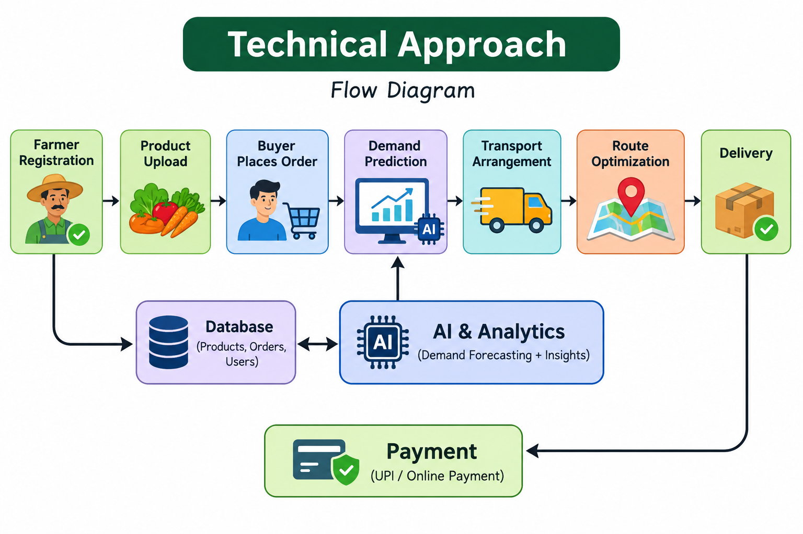

# Smart India Hackathon Workshop
# Date:24.11.2026
## Reference Number:
## Name:

## Problem Title
SIH 26033: Multiple intermediaries reduce farmers earnings and increase consumer prices.

## Problem Creater's Organization
Ministry of Consumer Affairs, Food & Public Distribution

## Theme
Agriculture, FoodTech & Rural Development

## Problem Description
Expected Solution: Create a digital marketplace that:

• Connects farmers/FPOs directly with consumers and bulk buyers.
• Provides logistics support.
• Uses AI for demand forecasting and route optimization.

Benefits:

• Better prices for farmers.
• Lower prices for consumers.
• Reduced supply chain inefficiencies.

## Proposed Solution
I am planning to develop a digital platform that connects farmers and FPOs directly with consumers and bulk buyers. Farmers can add details about their products, quantity, quality and price. Buyers can view the available products and place orders directly.

The platform will also use AI to predict the demand for different products. This can help farmers decide what to sell and when to sell it. I will also include a logistics system to help arrange transportation and find suitable delivery routes.

This can reduce the need for multiple intermediaries and help farmers get better prices while keeping prices reasonable for consumers.

## Technical Approach
I will develop a web-based platform with separate access for farmers and buyers. A database will store farmer, product, order and payment details.

AI will be used to study previous sales, demand and other available data to predict future demand. GPS and route optimization will be used to find better delivery routes.

## Feasibility and Viability
The project can be developed using technologies that are already available, such as web applications, databases, GPS, cloud services and AI.

I can first test the system with a small number of farmers and FPOs and later expand it to more areas.

Some challenges may be lack of digital knowledge, internet problems, product quality issues and transportation availability. These can be handled through simple interfaces, local FPO support, product verification and local transport partners.

## Impact and Benefits
This platform can help farmers sell their products directly to more buyers and reduce their dependence on intermediaries. This can improve the price received by farmers.

Consumers and bulk buyers can get products at more reasonable prices. Demand prediction can also help reduce excess production and food wastage.

Main benefits:
 Better income opportunities for farmers
 Lower prices for consumers
 Fewer intermediaries
 Better market access
 Reduced food wastage
 Lower transportation costs

## Research and References
I referred to information related to agricultural supply chains, farmer markets, FPOs, demand forecasting, logistics and food wastage while developing this idea.

References:
 Ministry of Agriculture & Farmers Welfare
 Ministry of Consumer Affairs, Food & Public Distribution
 NABARD
 NITI Aayog
 Food and Agriculture Organization (FAO)
 Agricultural market and price-related data
